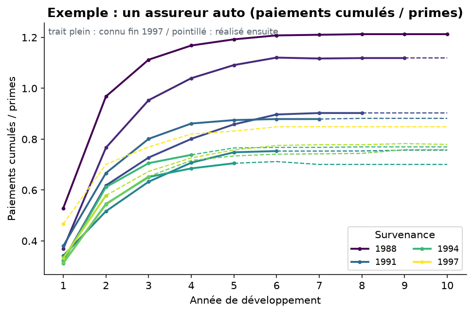
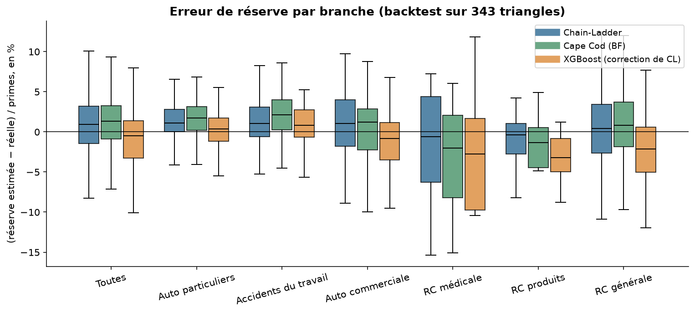
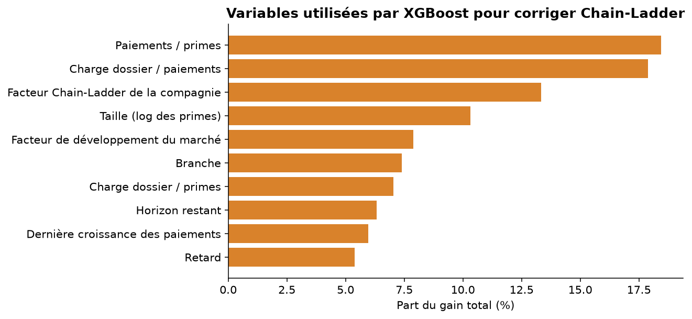
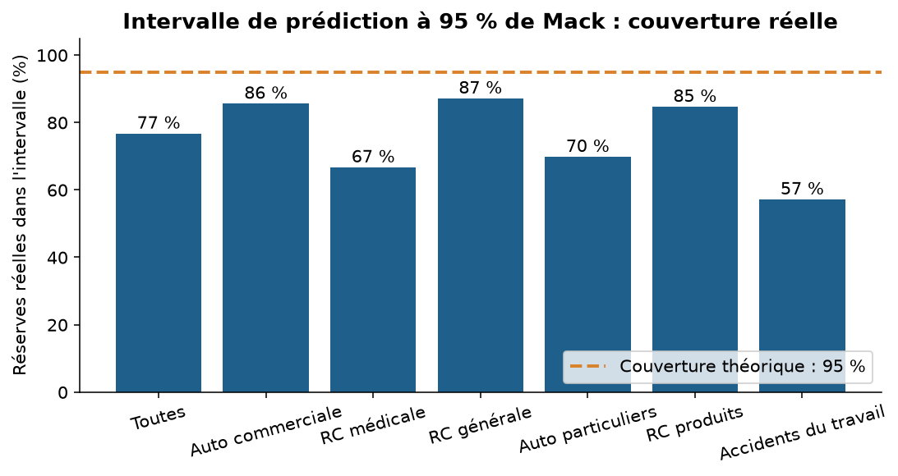
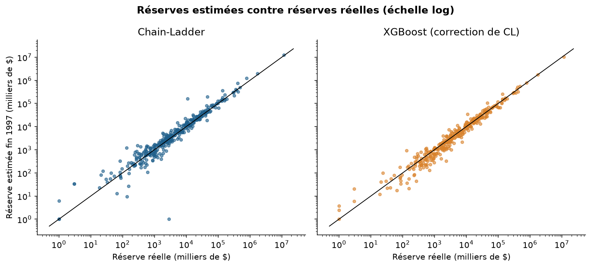

# Provisionnement : Chain-Ladder, Mack et Cape Cod face au machine learning

**Backtest sur 343 triangles réels de sinistres.** Pour chaque assureur et chaque branche, on estime fin 1997 la réserve de sinistres avec les méthodes actuarielles classiques et avec un modèle XGBoost, puis on compare chaque estimation à ce que les assureurs ont **réellement payé ensuite** (1998-2006).

Données : [CAS Loss Reserving Database](https://www.casact.org/publications-research/research/research-resources/loss-reserving-data-pulled-naic-schedule-p) (Meyers & Shi), base publique de la Casualty Actuarial Society construite à partir des états réglementaires « Schedule P » des assureurs américains. Six branches : auto particuliers, accidents du travail, auto commerciale, RC médicale, RC produits, RC générale.



## Pourquoi cette base

Chaque triangle est un **carré complet** de 10 années de survenance × 10 années de développement. La partie haute (années calendaires ≤ 1997) est ce qu'un actuaire connaissait fin 1997 ; la partie basse s'est réalisée ensuite. On peut donc mesurer l'erreur réelle de chaque méthode, ce qui est impossible sur un triangle classique.

## Méthodes comparées

| Méthode | Principe |
|---|---|
| **Chain-Ladder** | Facteurs de développement pondérés par les volumes, appliqués au dernier paiement connu |
| **Mack (1993)** | Erreur de prédiction de Chain-Ladder, intervalle de prédiction à 95 % (log-normal) |
| **Cape Cod (Bornhuetter-Ferguson)** | Réserve = ratio sinistres / primes a priori × prime × part non encore développée ; ratio estimé par Cape Cod |
| **XGBoost** | Apprend, sur les **autres** compagnies, la correction à apporter au développement Chain-Ladder |

Chain-Ladder, Mack et Cape Cod sont implémentés à la main dans [`src/chainladder.py`](src/chainladder.py) et validés sur le triangle de référence **RAA** (Mack, 1993) : réserve totale 52 135 et erreur standard de Mack 26 909, identiques au package R `ChainLadder`.

### Le modèle de machine learning

Chain-Ladder n'utilise que les paiements passés d'une seule compagnie. Le modèle ML part du développement Chain-Ladder de la compagnie et apprend à le corriger avec des informations que Chain-Ladder ignore :

- **charge dossier / paiements** : les provisions dossier par dossier annoncent les paiements à venir ;
- **paiements / primes** : le niveau de sinistralité déjà atteint ;
- le développement moyen du **marché** pour la branche, la taille de l'assureur, le retard, l'horizon restant.

Cible : log(développement réel) − log(développement Chain-Ladder). Quand le modèle n'a pas d'information utile, il retombe sur Chain-Ladder. Les paiements cumulés ne pouvant pas baisser, l'ultime prédit est au moins égal au dernier paiement connu.

**Sans fuite d'information :**

- le modèle n'est entraîné que sur des cellules connues fin 1997 ;
- **chaque compagnie est provisionnée par un modèle qui ne l'a jamais vue** (validation croisée à 5 plis par compagnie) ;
- un test unitaire vérifie que modifier le « futur » d'un triangle ne change rien à l'entraînement ni aux prédictions.

## Résultats

| Toutes branches (343 triangles) | Chain-Ladder | Cape Cod | XGBoost |
|---|---|---|---|
| Erreur quadratique moyenne, en % des primes | 6,6 | 5,4 | **4,5** |
| Erreur absolue médiane, en % de la réserve réelle | 25,0 | 25,7 | **23,6** |
| Biais total (réserves estimées vs réelles) | +12,8 % | +14,6 % | −6,0 % |
| Triangles où la méthode bat Chain-Ladder | – | – | 56 % |

Résultats stables : en changeant le découpage aléatoire des compagnies, l'erreur quadratique du modèle ML reste entre 4,5 et 5,0 % des primes.



Détail par branche : [`outputs/resume_par_branche.csv`](outputs/resume_par_branche.csv) ; résultat de chaque triangle : [`outputs/backtest_par_triangle.csv`](outputs/backtest_par_triangle.csv).

**Ce qu'il faut retenir**

- **Le ML réduit surtout les grosses erreurs.** L'erreur médiane bouge peu, mais l'erreur quadratique baisse d'un tiers par rapport à Chain-Ladder : le modèle évite les dérapages, notamment en RC médicale et en RC produits, où Chain-Ladder est très instable.
- **Les provisions dossier sont l'information la plus utile** après le niveau de sinistralité : c'est l'intuition des méthodes de type *Munich Chain-Ladder*, retrouvée ici par le modèle.
- **Attention au sens du biais.** Chain-Ladder surestime les réserves sur la période (+12,8 %), le ML les sous-estime légèrement (−6 %). En pratique, une sous-estimation est plus risquée pour un assureur : un modèle ML devrait servir de second avis, pas remplacer l'actuaire.
- **L'intervalle à 95 % de Mack est trop étroit** : il ne contient la vraie réserve que dans 77 % des cas (57 % en accidents du travail). C'est le constat de Meyers (2015) sur la même base : le modèle de Mack sous-estime l'incertitude.

| Variables utilisées par le modèle | Couverture réelle de l'intervalle de Mack |
|---|---|
|  |  |



**Notebook pas à pas :** [`notebooks/analyse_provisionnement.ipynb`](notebooks/analyse_provisionnement.ipynb) reprend la validation sur RAA, un exemple de triangle, le backtest complet et les graphiques, déjà exécutés. Il s'affiche directement sur GitHub, sans rien installer.

## Lancer le projet

```bash
python -m venv .venv
.venv\Scripts\activate            # Windows (source .venv/bin/activate sous Linux / macOS)
pip install -r requirements.txt

python main.py                    # télécharge les données CAS (une fois), backtest complet, écrit outputs/
python -m pytest                  # tests unitaires (dont RAA et absence de fuite)
```

Durée : environ 1 minute.

## Structure

```
├── notebooks/              # notebook pas à pas, déjà exécuté
├── main.py                 # backtest complet
├── src/
│   ├── data.py             # téléchargement CAS, contrôle qualité, triangles 10 × 10
│   ├── chainladder.py      # Chain-Ladder, Mack, Cape Cod (implémentation propre)
│   ├── ml.py               # XGBoost : variables, entraînement, validation croisée par compagnie
│   ├── backtest.py         # réserve réelle, métriques par branche
│   └── plots.py            # figures
├── tests/                  # RAA (Mack 1993), absence de fuite, tailles des tables
├── outputs/                # figures, résultats par triangle et par branche
└── requirements.txt
```

## Limites et pistes

- Les données couvrent 1988-1997 ; les cadences de règlement ont changé depuis.
- Contrôle qualité volontairement simple (primes et paiements positifs) : 343 triangles retenus sur 779.
- Pas de facteur de queue : l'ultime est pris au retard 10, comme dans la base.
- Pistes : bootstrap ODP pour comparer à Mack sur l'incertitude, modèle ML probabiliste (quantiles) pour produire ses propres intervalles, comparaison avec les réserves comptabilisées par les assureurs.

## Références

- Mack, T. (1993). *Distribution-free calculation of the standard error of chain ladder reserve estimates.* ASTIN Bulletin.
- Meyers, G. (2015). *Stochastic Loss Reserving Using Bayesian MCMC Models.* CAS Monograph 1.
- Meyers, G. & Shi, P. *Loss Reserving Data Pulled From NAIC Schedule P.* Casualty Actuarial Society.

## Outils

Python · NumPy · pandas · XGBoost · SciPy · Matplotlib
